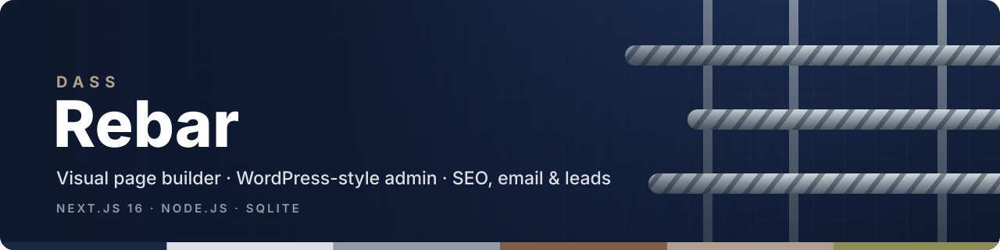
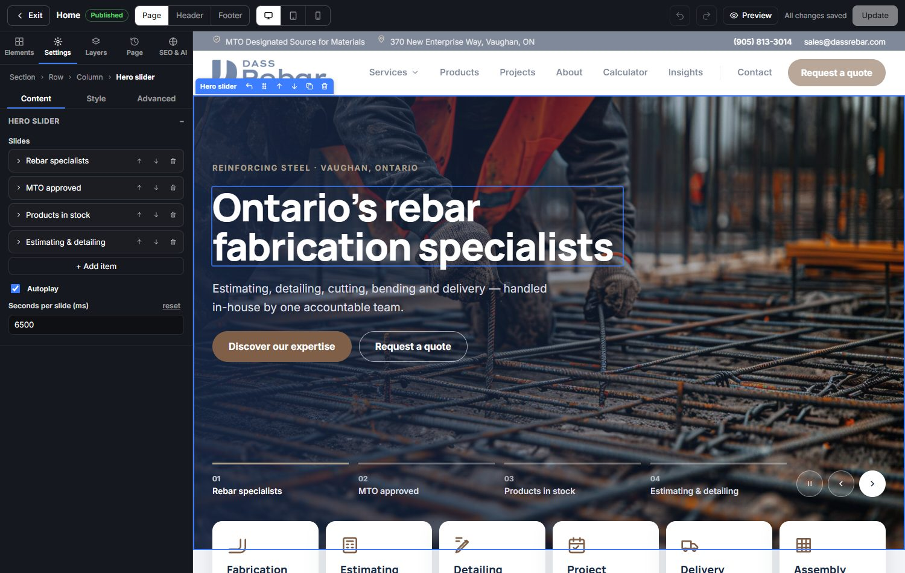
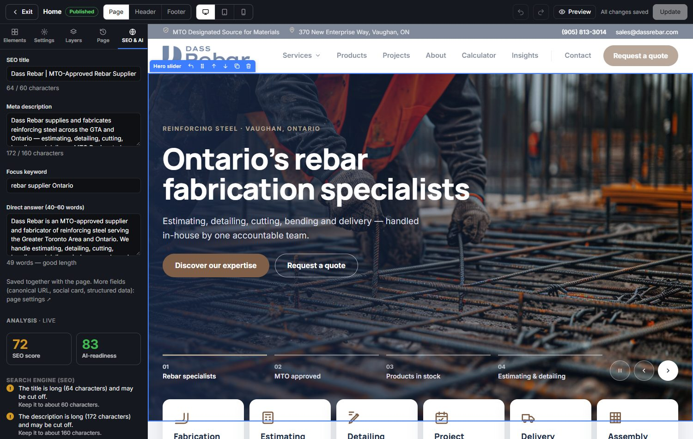
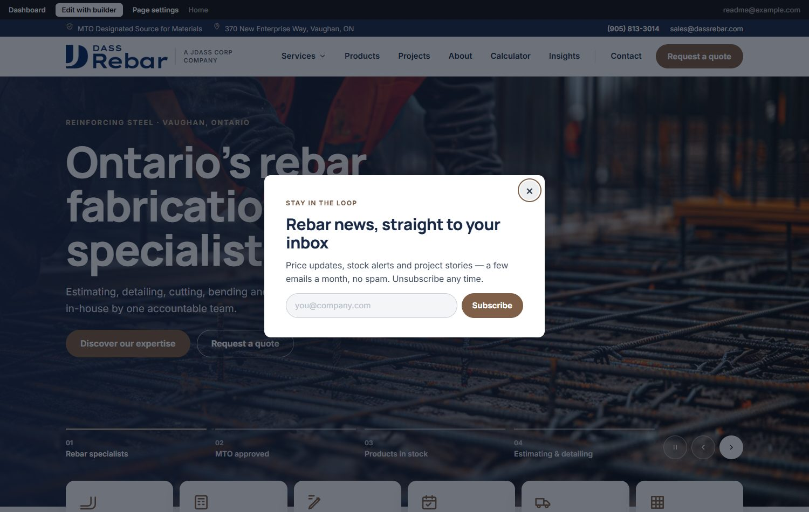
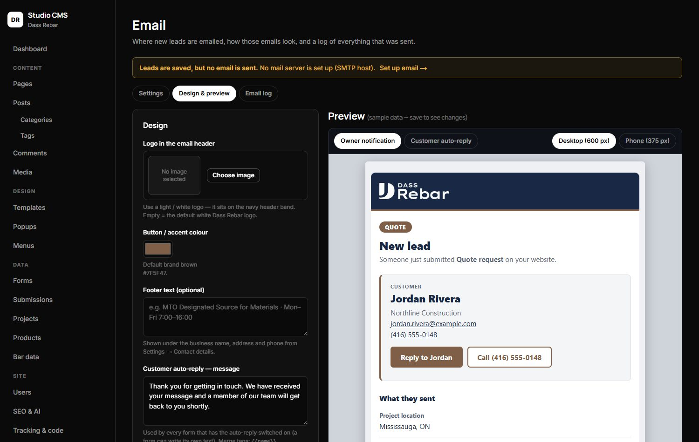
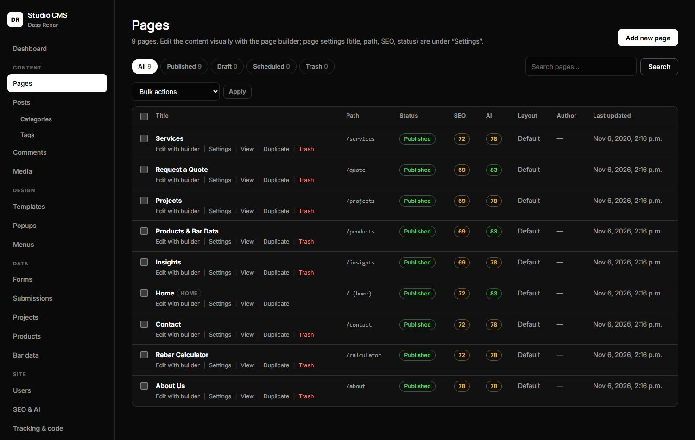
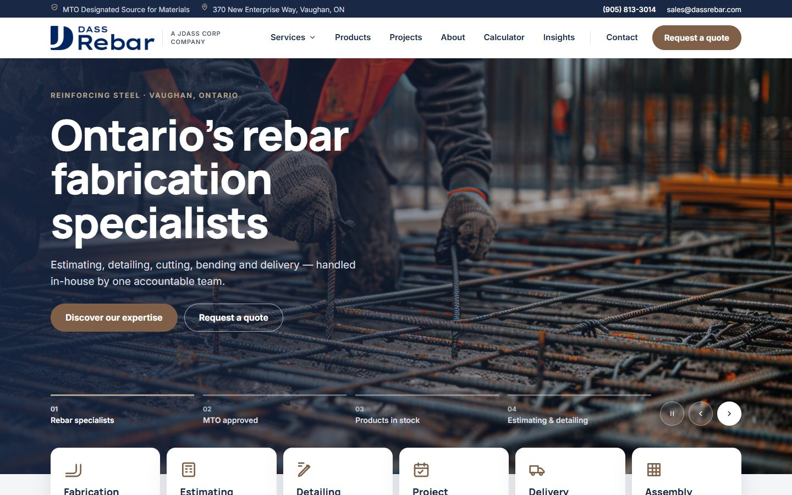
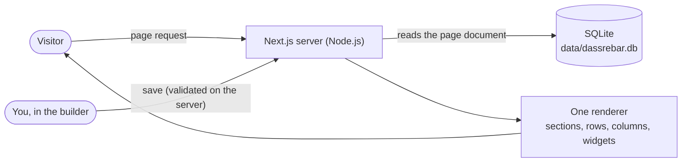
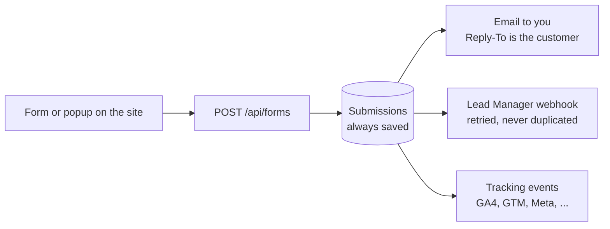
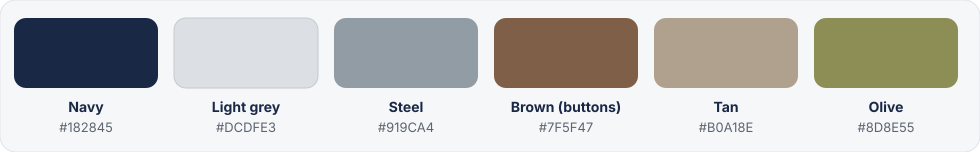

<p align="center">
  
</p>

<p align="center">
  
  
  
  
  
  
</p>

<p align="center">
  <a href="#quick-start">Quick start</a> &nbsp;·&nbsp;
  <a href="#visual-page-builder">Page builder</a> &nbsp;·&nbsp;
  <a href="#studio-cms-admin">Admin</a> &nbsp;·&nbsp;
  <a href="#seo-ai-visibility-and-tracking">SEO &amp; AI</a> &nbsp;·&nbsp;
  <a href="#forms-popups-email-and-lead-manager">Leads</a> &nbsp;·&nbsp;
  <a href="#configuration">Configuration</a> &nbsp;·&nbsp;
  <a href="#deploying-to-hostinger">Deploy</a>
</p>

<p align="center">
  
</p>

The Dass Rebar website is a **Next.js 16 Node.js server with a SQLite database**. Every public page is a document you can edit **on the page itself**, like Elementor. A
WordPress-style admin, **Studio CMS**, manages everything around it: posts, media, menus, forms, popups, SEO, email and lead capture.

## What you get

| Edit visually | Run it like WordPress | Be found, and capture every lead |
|---|---|---|
| Click any text, image, video or link and change it on the page<br>Drag sections, rows, columns and widgets to reorder them<br>Per-device styling for desktop, tablet and mobile<br>Undo / redo, layers, revisions, reusable sections<br>Header and footer are editable the same way | Pages, posts, categories, tags and comments<br>Media library with video and documents<br>Menus, templates and redirects<br>Users with Administrator, Editor and Author roles<br>Import / export, activity log, site settings | SEO, GEO, AEO and AIO tools with a live score<br>JSON-LD, `llms.txt`, AI-crawler rules, sitemap<br>Analytics, Tag Manager and pixels by ID<br>Forms and popups built in the page builder<br>Every enquiry emailed to you and sent to Lead Manager |

## Take a look

<table>
  <tr>
    <td width="50%"><br><sub><b>Live SEO &amp; AI check</b> while you edit: scores, fixes, direct answer, focus keyword</sub></td>
    <td width="50%"><br><sub><b>Popups</b> built in the same page builder, with triggers and display rules</sub></td>
  </tr>
  <tr>
    <td><br><sub><b>Lead emails</b>: branded, with a Reply button that writes straight to the customer</sub></td>
    <td><br><sub><b>Studio CMS</b>: every page with its SEO and AI-readiness score</sub></td>
  </tr>
</table>

<p align="center">
  
  &nbsp;
  
</p>

## Quick start

Requires **Node.js 22.13 or newer**. The database is Node's built-in SQLite, so there is nothing to compile.

```bash
npm install
npm run seed                                  # creates data/dassrebar.db with the site's pages, header/footer, menus and content
npm run admin:create -- you@example.com       # creates your login and prints a password once (or pass your own as the 2nd argument)
npm run dev                                   # site: http://localhost:3000   admin: http://localhost:3000/admin
```

Sign in at `/admin`, open any page on the site and press **Edit with builder** in the black bar at the top.
Production: `npm run build && npm start`.

> **After pulling changes** that add or remove routes, stop `npm run dev`, delete the `.next` folder and start it again. A long-running dev server keeps the old compiled layout and can show a header or footer twice. The database updates itself on start.

## How it works



- **Every public page is a document** in the database (`sections > rows > columns > widgets`), drawn by one renderer. The header and footer are documents too.
- **One catch-all route** serves whatever page is stored at the requested path. Public pages are rendered on every request, so an edit is live as soon as you press Update.
- **Everything the builder saves is validated on the server** against the widget schema. Unknown settings are dropped, rich text goes through an allow-list sanitiser, links are checked, and the Custom HTML block is administrator-only.
- **The data lives in one folder** (`data/`): the database, uploaded media and private files. Copy it and you have a backup.

## Visual page builder

- **Edit in place.** Click text and type. Select text for bold, italic, links, headings and lists. Click an image, video or button to change it in the left panel.
- **Arrange.** Drag elements from the **Elements** tab, or drag existing ones by the handle on their toolbar. Use the **+** between sections to add one, and change a row's columns from its toolbar.
- **Style per device.** Each element has **Content**, **Style** and **Advanced** tabs. Switch between desktop, tablet and mobile previews and set different values for each.
- **Work safely.** Undo / redo (`Ctrl+Z`, `Ctrl+Y`), save with `Ctrl+S`, a **Layers** navigator, and **Page** history with a revision on every save. If someone else saved the page first, you are warned instead of overwriting their work.
- **Reuse.** *Save to library* turns a section into a saved section you can insert as a copy or as a live link that updates everywhere.
- **Header, footer and popups.** Switch between **Page**, **Header** and **Footer** at the top. Popups open in a popup-shaped canvas with their own settings tab.
- **SEO & AI tab.** Title, description, focus keyword and a direct answer, with a live analysis next to your content.

<details>
<summary><b>All widgets</b></summary>

<br>

| Group | Widgets |
|---|---|
| Basic | Heading, text, image, button, spacer, divider, icon, icon box, list, counter, accordion (with optional FAQ structured data), social icons |
| Media | Video (upload, YouTube, Vimeo), image gallery with lightbox, hero slider, map |
| Site | Navigation menu, logo, saved section, custom HTML (administrators only) |
| Data-driven | Projects, insights, products, bar-data table and diagrams |
| Tools and forms | Weight calculator, quote wizard, contact form, newsletter, and *Custom form* (any form you build under Forms) |

</details>

## Studio CMS (admin)

Open `/admin`. What you see depends on your role.

| Area | What it does |
|---|---|
| **Dashboard** | Counts, a quick draft, recent pages, submissions and activity, and setup warnings (for example "no email is set up") |
| **Pages** | Published / Draft / Scheduled / Trash tabs, search, bulk actions, SEO and AI scores, page settings, revisions |
| **Posts**, **Categories**, **Tags**, **Comments** | Articles with scheduling, authors and SEO; public comments with moderation and replies |
| **Media** | Images, video up to 50 MB and documents, with folders, alt text, replace file and a picker used everywhere |
| **Templates**, **Popups**, **Menus** | Header, footer and saved sections; popups; a drag-and-drop menu builder |
| **Forms**, **Submissions** | Build forms from templates; every lead from every form is stored, filterable and exportable as CSV |
| **Projects**, **Products**, **Bar data** | The content behind the data-driven widgets |
| **Users** | Roles, password reset, reassign content on delete |
| **SEO & AI**, **Tracking & code** | See [SEO, AI visibility and tracking](#seo-ai-visibility-and-tracking) |
| **Redirects** | 301, 302, 307 and 308 with hit counts, CSV import, loop checks; made automatically when a page path changes |
| **Email**, **Lead Manager** | See [Forms, popups, email and Lead Manager](#forms-popups-email-and-lead-manager) |
| **Import / Export**, **Activity log**, **Settings** | JSON export and a dry-run-first import; who changed what; site identity, contact details and brand colours |

**Roles.**
*Administrator* can do everything.
*Editor* works on pages and the builder, all posts, media, comments, submissions, projects, products, popups and forms.
*Author* manages their own posts and media.
Users, settings, header and footer, redirects, import / export, **SEO & AI**, **Tracking & code**, **Email** and **Lead Manager** are administrator-only.

## SEO, AI visibility and tracking

Four goals, one place. Per-page fields live in the builder's **SEO & AI** tab and in each page's settings; site-wide settings are under **SEO & AI** in the admin.

| Goal | In plain terms | What the site does |
|---|---|---|
| **SEO** | Ranking in classic search | Title template, canonical URLs, index / follow per page, Open Graph and Twitter cards, search-console verification codes, a sitemap with last-modified dates that skips noindex pages, redirects, and a 404 monitor that turns a missing address into a redirect in one click |
| **GEO** | Being cited by ChatGPT, Perplexity, Claude and Gemini | `llms.txt` and `llms-full.txt`, an allow / block table for 13 AI crawlers in `robots.txt`, and a business profile that feeds structured data |
| **AEO** | Being the quoted answer | A 40 to 60 word **direct answer** per page and FAQ structured data from accordion blocks |
| **AIO** | Google AI Overviews | Question-style headings, lists, tables and an answer-first structure, checked by the live **SEO & AI** score |

- **Structured data (JSON-LD)** is generated on public pages: Organization or LocalBusiness, WebSite, WebPage subtypes, breadcrumbs, articles and FAQ.
- **A live check** scores every page for SEO and for AI-readiness and tells you what to fix. The scores also appear in the Pages list.

**Tracking and custom code** (administrators only). Paste only an ID for **Google Analytics 4**, **Google Tag Manager**, **Google Ads**, **Meta Pixel**, **LinkedIn Insight**, **TikTok Pixel** or **Microsoft Clarity**; IDs are strictly validated.
Add custom CSS, header code, body-open code and footer code for the whole site or for one page.
Nothing here is ever output in `/admin` or inside the builder canvas (custom CSS is shown in the builder so you can see its effect), and signed-in staff are not tracked unless you turn that off.
Successful form submissions are sent to your trackers as conversion events.

More detail: [`docs/SEO-AND-TRACKING.md`](docs/SEO-AND-TRACKING.md).

## Forms, popups, email and Lead Manager



- **Forms.** Start from Contact, Quote, Callback, Newsletter, Feedback or Blank. Add text, email, phone, textarea, select, radio, checkboxes, consent, number, date, hidden and file fields. Place the form on a page or in a popup with the **Custom form** widget. Each form shows where it is used.
- **Popups.** Modals, slide-ins, top and bottom bars and full-screen popups, designed in the page builder and switched on only when you press **Activate**. Triggers: after a delay, on scroll, on exit intent, after inactivity, after N page views, or when a visitor clicks a button or link set to **Open popup**. Rules: pages (with wildcards), devices, signed-out visitors only, a start and end date, and how often each visitor sees it. They are keyboard and screen-reader friendly, and never appear in the admin or while you edit other pages in the builder.
- **Lead email.** Every enquiry from any form is emailed to the addresses you set under **Email**, in a branded design with a live preview. The email shows who wrote, what they sent and where from. **Replies go straight to the customer**: the From line is your own authenticated address ("Customer name via Dass Rebar", so mail is delivered), and Reply-To is the customer. Failed sends are retried and listed in an email log with a Resend button. An optional thank-you auto-reply can be switched on per form.
- **Lead Manager.** Every enquiry, including newsletter sign-ups, is also sent to your lead-management software over HTTPS, with a stable ID so a retry never creates a second lead. UTM tags, the landing page and the referrer travel with it. A delivery log lets you resend, and a **Send test lead** button checks the connection.
- **Leads are never lost.** The submission is saved first; email and Lead Manager run afterwards and failures never reach the visitor.

More detail, with provider setup (Hostinger, Gmail, Microsoft 365 and others): [`docs/POPUPS-FORMS-EMAIL.md`](docs/POPUPS-FORMS-EMAIL.md).

## Configuration

Everything is optional; the defaults work out of the box. Copy [`.env.example`](.env.example) to `.env.local` for local development. On Hostinger, set these in the Node.js app's **Environment variables** panel.
Email, Lead Manager and tracking are easiest to set up in the admin; the variables below are fallbacks.

| Variable | What it does |
|---|---|
| `DATA_DIR` | Where `dassrebar.db`, `uploads/` and `private/` live. Default: `./data`. On a server, point it **outside** the app folder |
| `SITE_URL` | Your public address, used for canonical links, the sitemap and emails |
| `APP_SECRET` | Key that encrypts saved secrets (the SMTP password and the Lead Manager address). Without it a random key file is created in `DATA_DIR/private/` |
| `SMTP_HOST` `SMTP_PORT` `SMTP_USER` `SMTP_PASS` `MAIL_FROM` `NOTIFY_EMAIL` | Fallback mail settings, used only while **Email** in the admin has none saved |
| `LEADMANAGER_URL` `LEADMANAGER_KEY` | Fallback Lead Manager webhook and optional API key, used only while nothing is saved in the admin. The address contains a secret token: keep it private |
| `ALLOWED_ORIGINS` | Only if saving in the admin fails with "Invalid Server Actions request" behind the host's proxy, for example `dassrebar.com,www.dassrebar.com` |
| `COOKIE_SECURE=false` | Only when testing a production build over plain http on a non-localhost address |
| `NEXT_DIST_DIR` | Development only: a second dev server needs its own build folder (Next.js allows one dev server per folder) |

## Deploying to Hostinger

> **Plan:** Hostinger runs Node.js apps only on **Business** and **Cloud** plans, not Premium or Single. Deploy to Cloud.

1. **Create a Node.js web app** in hPanel (Next.js preset) from this Git repository, or from an uploaded zip of the project (leave out `node_modules`, `.next*` and `data`).
2. **Node version:** choose **22.x or 24.x**.
3. **Commands:** install `npm install`, build `npm run build`, start `npm start`.
4. **Environment variables:** at least `DATA_DIR` pointing to a folder **outside** the app folder (for example `/home/<user>/dassrebar-data`) and `SITE_URL=https://yourdomain`.
5. **Add your content.** Stop the app, upload the contents of your local `data/` folder (`dassrebar.db`, `uploads/`, `private/`) into `DATA_DIR`, then start it. The database updates itself on start, so back it up first.
   Starting from nothing instead? Run `npm run seed` over SSH (with `DATA_DIR` set), then `npm run admin:create -- you@example.com`.
6. **Finish setup in the admin** at `https://yourdomain/admin`:
   - **Email**: enter your mailbox details and press *Send test email*.
   - **Lead Manager**: paste the webhook address and press *Send test lead*. This creates a real lead called "Test Person (website test)" in your Lead Manager, so delete it afterwards.
   - **Tracking & code**: add your analytics and pixel IDs.
   - **SEO & AI**: fill in the business profile.
7. **Check** `/robots.txt`, `/sitemap.xml` and `/llms.txt`, and send a test enquiry through a form.

**Back up `DATA_DIR` regularly.** It is the whole site: content, pages, uploads and the key that decrypts your saved secrets. If you move the database to another server, move the `private/` folder with it (or set the same `APP_SECRET`), or saved passwords will have to be entered again.

## Security

- Passwords are hashed with scrypt, login is rate-limited, and sessions are random tokens stored hashed in an `HttpOnly`, `SameSite=Lax`, `Secure` (production) cookie.
- Every admin page, route and action checks the session **and the role's capability** itself. Customer files are never public.
- Everything the builder saves is validated on the server. Rich text is sanitised, links must be http(s), mailto, tel or site paths, and Custom HTML is administrator-only. Two people saving the same page are detected.
- Public forms have a honeypot, rate limits, size limits and content-checked file types. SVG uploads are refused.
- **Secrets are encrypted at rest** (the SMTP password and the Lead Manager address and key), never sent back to the browser, never exported and redacted from logs and error messages. The Lead Manager address must be HTTPS and cannot point at a private or local network address.
- **Emails are safe by construction:** customer text is escaped, and line breaks are stripped from anything used in a header, so a form cannot inject extra recipients.
- Tracking IDs are format-checked. Custom code is raw by design, so it is **administrator-only**, is never output in the admin or builder, and is saved only by administrators.
- Visitor IP addresses are used only as hashed rate-limit keys. `/admin` and the builder canvas are `noindex` and uncached.

## Project layout

| Path | What is there |
|---|---|
| `app/(site)/[[...slug]]/` | The public site: one catch-all route renders the page stored at that path |
| `app/admin/` | Studio CMS. `app/admin/builder/` is the page builder and `app/builder-frame/` the editable canvas it embeds |
| `app/api/forms/` | The one endpoint every public form posts to; it saves the lead, then sends email and the Lead Manager forward |
| `app/robots.txt/`, `app/llms.txt/`, `app/llms-full.txt/`, `app/sitemap.ts` | Crawler and AI files, generated from your settings and pages |
| `proxy.ts` | Tells public pages apart from `/admin` and the builder, so trackers and custom code never appear there |
| `components/builder/` | The renderer, the widgets (`widgets/`), base styles and the editor (`editor/`) |
| `components/site/` | Public-site extras: tracking and custom code, popups, campaign attribution |
| `lib/builder/` | The widget and control schema, CSS generator, tree operations, sanitiser, SEO analysis |
| `lib/` | Database, roles, SEO, tracking, email, Lead Manager, popups, redirects |
| `db/` | The site's pages, templates, menus and popups as code, used by `npm run seed` |
| `docs/` | Guides: [builder](docs/BUILDER.md), [SEO and tracking](docs/SEO-AND-TRACKING.md), [popups, forms and email](docs/POPUPS-FORMS-EMAIL.md) |
| `data/` | **Your content.** Git-ignored |

**Restoring a page's original design:** `npm run seed -- --only=about` rewrites just that page (`--reset-pages` rewrites all).
`npm run seed -- --seo-fields` fills only empty focus-keyword and direct-answer fields and leaves your content alone.

## Good to know

- **No cookie-consent banner is included.** Add one before running analytics or pixels on EU or Canadian traffic.
- **Email delivery depends on your mail provider.** Use a From address on your own domain and set up SPF, DKIM and DMARC for it. Retry timers live in memory, so after a restart use *Resend* in the log for anything still failed.
- **Popups:** schedules use UTC, "how often" memory is per browser, and a top bar overlays the header rather than pushing the page down.
- **The builder's drag and drop** uses the browser's own drag and drop, so it is built for a mouse, not touch. It was tested in Microsoft Edge.
- **The SEO and AI scores are heuristics.** They point out common problems and make no promise about rankings or citations.

## Brand

<p align="center">
  
</p>

The colours are editable under **Settings** in the admin and are offered by the builder's colour pickers.
